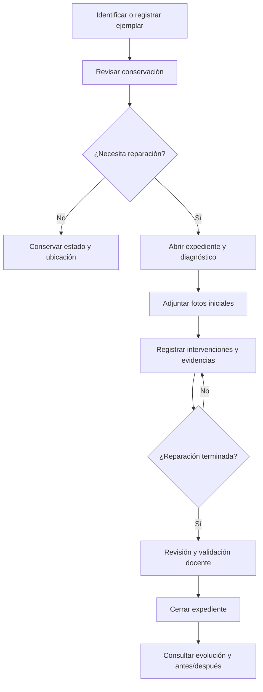
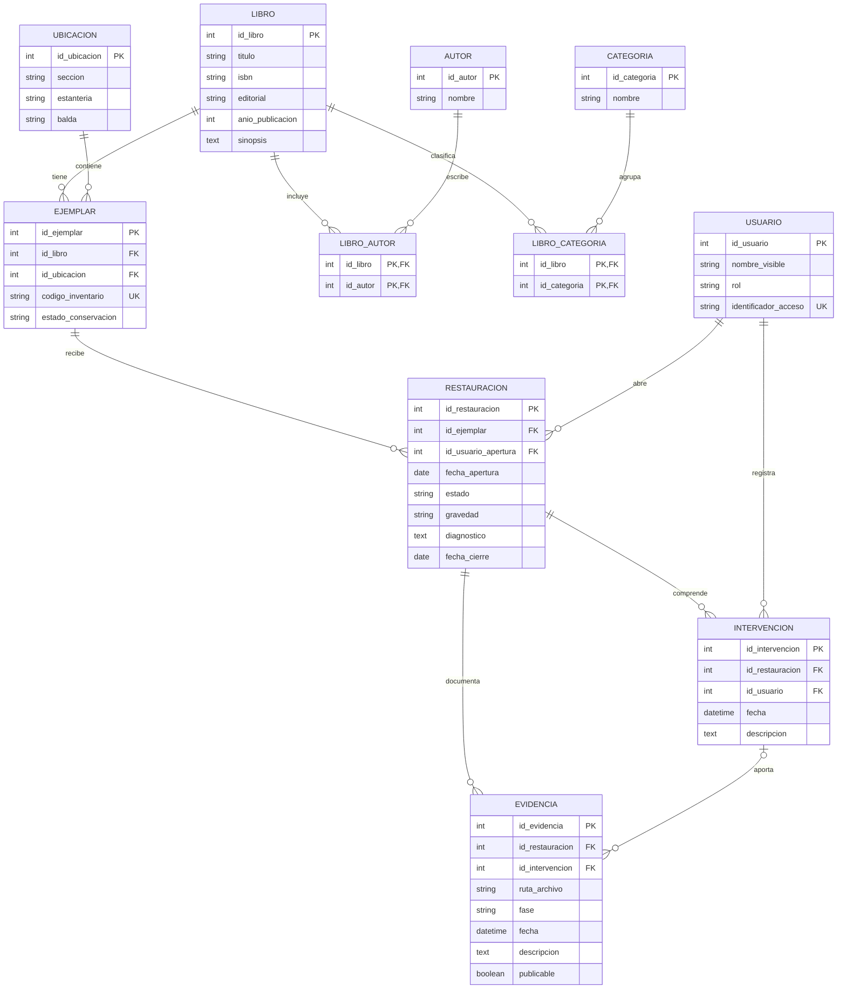

# Hospital-Libros-INNOVA

# Propuesta INNOVA 2026/2027

## Biblioteca Digital y Hospital de Libros

**Centro:** IES Virgen del Carmen (Jaén)  
**Proyecto INNOVA relacionado:** *Hospital de libros: Encuadernación, Lettering y Tecnología 3D*  
**Propuesta técnica:** Desarrollo de Aplicaciones Multiplataforma (DAM)  
**Estado:** Borrador para revisión con biblioteca y profesorado (6 de noviembre de 2026)

> **Idea principal:** crear una herramienta para registrar y localizar ejemplares de la biblioteca y documentar con fotografías su diagnóstico, reparación y evolución. Antes de decidir si se crea un catálogo completo, hay que comprobar si ya existe un sistema bibliotecario y si es posible integrarse con él.

---

## 1. Enunciado

Se propone desarrollar una aplicación informática que ayude a organizar los ejemplares de la biblioteca del IES Virgen del Carmen y a gestionar el proceso de restauración de los libros deteriorados dentro del proyecto INNOVA *Hospital de libros*.

Cada **ejemplar físico** tendrá un identificador único, datos de localización y un estado de conservación. Cuando se detecte un deterioro, el personal autorizado podrá abrir un **expediente de restauración**, describir los daños y añadir fotografías del estado inicial. Durante la reparación, el alumnado participante y el profesorado podrán registrar **intervenciones** con fecha, descripción y evidencias fotográficas. Al finalizar, se documentará el resultado y se conservará el historial para consultar el **antes, durante y después**.

La aplicación ofrecerá un buscador y una ficha por ejemplar. Se estudiará habilitar una **vista pública de las restauraciones aprobadas**, accesible desde una web del centro o mediante un código QR, sin publicar datos personales del alumnado. El alcance definitivo dependerá de las necesidades y herramientas que ya tenga la biblioteca.

### Objetivo general

Digitalizar el seguimiento de la conservación y restauración de los libros, facilitando el trabajo de la biblioteca y dando visibilidad educativa a las intervenciones realizadas en INNOVA.

### Objetivos específicos

1. Identificar y localizar cada ejemplar de manera inequívoca.
2. Consultar libros por título, autor, categoría, ISBN y ubicación, cuando existan esos datos.
3. Registrar diagnósticos de deterioro, gravedad y tipos de daño.
4. Gestionar expedientes y estados de restauración.
5. Documentar cada intervención con descripciones, fechas y fotografías.
6. Mostrar una línea temporal y comparativas del antes y después.
7. Mantener trazabilidad de quién registra o valida cada cambio, con acceso restringido.
8. Obtener informes básicos sobre ejemplares pendientes, en reparación y recuperados.
9. Valorar la importación o integración con el catálogo bibliotecario existente.
10. Diseñar el sistema de modo que admita ampliaciones sin rehacer la base de datos.

---

## 2. Usuarios y funcionalidades

| Perfil | Funciones previstas |
|---|---|
| Responsable de biblioteca | Consultar y gestionar ejemplares, registrar diagnósticos, abrir expedientes y supervisar el catálogo. |
| Profesorado coordinador | Supervisar intervenciones, validar cierres y aprobar qué evidencias pueden publicarse. |
| Alumnado participante autorizado | Registrar avances y subir evidencias en expedientes asignados, sujetos a revisión. |
| Visitante público (opcional) | Buscar fichas y visualizar únicamente restauraciones y fotografías publicadas. |
| Administrador técnico | Configurar roles, copias de seguridad y mantenimiento. |

**Funciones mínimas (MVP):** alta/consulta de ejemplares o importación de sus referencias; buscador; diagnóstico; apertura de expediente; registro de intervenciones; carga de imágenes; línea temporal; cierre validado; autenticación y permisos.

**Ampliaciones opcionales:** etiquetas QR, lector de códigos de barras, comparador de imágenes, informes PDF, estadísticas, préstamos, sinopsis y recomendaciones, apoyo de IA para clasificar daños o redactar borradores con revisión humana.

### Ejemplo de uso

- Se identifica el ejemplar `BIB-0042` de una obra con varios ejemplares físicos.
- Se observa el lomo despegado y se abre un expediente con fotos iniciales.
- El alumnado registra la limpieza y la reparación de la encuadernación, con imágenes de cada fase.
- El profesorado revisa las evidencias y valida el cierre.
- La ficha muestra el historial cronológico y una comparación visual antes/después.

**Importante:** el estado de conservación y la disponibilidad para préstamo no son lo mismo. Un ejemplar puede estar restaurado, pero no estar disponible por otros motivos.

---

## 3. Flujo de trabajo

Estados sugeridos del expediente: **pendiente**, **en reparación**, **en revisión**, **finalizado** y **cancelado**. Los motivos de cancelación o de imposibilidad de reparación deben quedar registrados.

---

## 4. Diseño preliminar de la base de datos

### 4.1. Decisión de modelado

Una **obra/edición bibliográfica** puede disponer de varios **ejemplares físicos**. El historial de deterioros y reparaciones pertenece al ejemplar, no al título. Un ejemplar puede pasar por varias restauraciones a lo largo de los años; cada restauración puede tener múltiples intervenciones y evidencias.

### 4.2. Diagrama entidad-relación (borrador lógico)

**Notas del diagrama:** `id_intervencion` en `EVIDENCIA` es opcional: una fotografía del diagnóstico inicial puede vincularse directamente al expediente. Las tablas puente permiten varios autores y categorías por libro. El esquema es conceptual/lógico, no SQL definitivo; la sintaxis de claves compuestas y restricciones se concretará al elegir el gestor de base de datos.

### 4.3. Diccionario resumido de entidades

| Entidad | Finalidad |
|---|---|
| `LIBRO` | Datos bibliográficos de una edición o registro catalográfico. |
| `AUTOR`, `LIBRO_AUTOR` | Autores y relación muchos-a-muchos con libros. |
| `CATEGORIA`, `LIBRO_CATEGORIA` | Materias y géneros, con clasificación múltiple. |
| `UBICACION` | Sección, estantería y balda. |
| `EJEMPLAR` | Copia física identificada de manera única y su conservación actual. |
| `RESTAURACION` | Expediente con diagnóstico, gravedad, fechas y estado. |
| `INTERVENCION` | Trabajo realizado en una fase del expediente. |
| `EVIDENCIA` | Metadatos y ruta de una fotografía o documento asociado. |
| `USUARIO` | Cuenta autorizada y rol de acceso. |

### 4.4. Reglas y restricciones por confirmar

- `codigo_inventario` debe ser único y no depender del ISBN.
- El ISBN puede ser nulo para libros antiguos o registros incompletos; no identifica por sí solo cada ejemplar.
- No se cerrará un expediente sin validación del perfil autorizado.
- Las evidencias de intervenciones deben pertenecer al mismo expediente que la intervención.
- No se eliminarán historiales de reparación sin procedimiento autorizado; se preferirá cierre o anulación trazable.
- Los archivos de imágenes se guardarán en almacenamiento protegido; la base de datos conservará su ruta y metadatos.
- La publicación externa de imágenes será opcional y requerirá aprobación.
- Si se registran múltiples participantes por intervención, se añadirá una tabla puente `INTERVENCION_PARTICIPANTE`.
- Se revisarán copias de seguridad, permisos, retención de imágenes y protección de datos antes del uso real.

---

## 5. Interfaz prevista

**Pantalla de catálogo:** buscador y filtros por título, autor, categoría, ubicación y conservación. Cada resultado muestra los ejemplares existentes.

**Ficha de ejemplar:** datos bibliográficos, código, localización, estado y expedientes anteriores.

**Expediente de restauración:** diagnóstico, tipo y gravedad de los daños, responsable, estado y actuaciones previstas.

**Línea temporal:** tarjetas ordenadas por fecha con texto y fotografías de cada intervención.

**Comparador visual:** imagen inicial frente a imagen final (cuando ambas existan y estén aprobadas).

**Panel de biblioteca:** recuentos y filtros de pendientes, en curso y finalizados, con exportación básica.

**Acceso público opcional:** ficha resumida y restauraciones autorizadas, sin información privada ni identificaciones del alumnado.

---

## 6. Relación con módulos de DAM

| Módulo / ámbito | Aplicación real en el proyecto |
|---|---|
| **Programación** | Clases, lógica de negocio, validación de expedientes, gestión de estados y pruebas. |
| **Bases de Datos** | Entidad-relación, modelo relacional, normalización, SQL, integridad y consultas. |
| **Entornos de Desarrollo** | IDE, repositorio Git, depuración, pruebas, documentación y versiones. |
| **Sistemas Informáticos** | Despliegue, usuarios, permisos, copias de seguridad y mantenimiento. |
| **Lenguajes de Marcas** | Interfaz web HTML/CSS, intercambio JSON/XML y documentación estructurada. |
| **Digitalización aplicada** | Sustitución de registros manuales por trazabilidad digital. |
| **Sostenibilidad aplicada** | Reparación, reutilización de libros y métricas de conservación de recursos. |
| **Itinerario Personal para la Empleabilidad** | Planificación, organización, comunicación con responsables y documentación profesional. |

**Aclaración:** se pretende aplicar conocimientos de todos estos ámbitos, incluso de módulos convalidados. Su posible reconocimiento o evaluación depende del profesorado y de las normas del centro.

### Tecnologías posibles (sin decidir aún)

- **Base de datos:** PostgreSQL o MySQL/MariaDB.
- **Aplicación:** web adaptable a móvil, con backend en Java o Python, según lo que acuerde el profesorado.
- **Imágenes:** almacenamiento en servidor con rutas en la base de datos y controles de acceso.
- **Control de versiones:** Git y repositorio del proyecto.
- **Hardware opcional:** lector de códigos de barras, etiquetas QR y pequeño puesto de fotografía; Raspberry Pi solo si aporta utilidad real.
- **IA / ciencia de datos opcionales:** clasificación asistida de daños, propuestas de etiquetas, estadísticas y resúmenes revisados por una persona. No se presupone que exista un conjunto de datos suficiente para entrenar modelos.

---

## 7. Plan de desarrollo por fases

| Fase | Entregable | Prioridad |
|---|---|---|
| **0. Reunión y análisis** | Necesidades reales, software existente, responsables, alcance y permisos. | Imprescindible |
| **1. Diseño de datos** | E/R revisado, modelo relacional, reglas y ejemplos de registros. | Imprescindible |
| **2. Prototipo** | Alta/importación de ejemplares, búsqueda y expedientes. | Imprescindible |
| **3. Seguimiento visual** | Intervenciones, fotos, línea temporal y cierre validado. | Imprescindible |
| **4. Prueba piloto** | Prueba con un conjunto reducido de ejemplares y correcciones. | Imprescindible |
| **5. Ampliaciones** | QR, comparador, estadísticas avanzadas, informes e IA. | Opcional |

**Criterio de éxito del prototipo:** que la biblioteca pueda identificar un ejemplar, registrar sus daños, documentar al menos una reparación con fotografías y consultar su evolución sin perder trazabilidad.

---

## 8. Preguntas para la bibliotecaria y el profesorado

### Sobre el funcionamiento actual

1. ¿Existe ya un programa o catálogo digital? ¿Cuál y qué funciones ofrece?
2. ¿Se podría importar su información o consultar los datos de forma autorizada?
3. ¿Cómo se identifica cada ejemplar: número de inventario, código de barras, ISBN u otro sistema?
4. ¿Cómo se organizan las ubicaciones y categorías de la biblioteca?

### Sobre la restauración

5. ¿Quién detecta y decide qué libros se apartan para reparar?
6. ¿Qué tipos de daños convendría registrar y cómo se valora su gravedad?
7. ¿Qué fases reales sigue una restauración y quién valida su finalización?
8. ¿Qué fotografías y datos serían útiles para documentar el antes, durante y después?
9. ¿Puede un libro pasar varias veces por el proceso de restauración?

### Sobre el uso de la aplicación

10. ¿Quién introduciría datos y fotografías: bibliotecaria, profesorado, alumnado o varios perfiles?
11. ¿Qué información podría mostrarse públicamente y qué debería permanecer restringido?
12. ¿Sería útil acceder a la ficha mediante QR o código de barras?
13. ¿Qué es más urgente: inventariar, registrar reparaciones, buscar libros o consultar estadísticas?
14. ¿Qué equipo, conexión y espacio de almacenamiento hay disponibles?
15. ¿Quién mantendría el sistema y haría las copias de seguridad cuando el proyecto termine?

---

## 9. Decisiones pendientes de validar

- [ ] Confirmar si se crea catálogo propio o módulo complementario al sistema existente.
- [ ] Acordar quién es responsable funcional del proyecto.
- [ ] Revisar qué datos de ejemplares ya existen y su calidad.
- [ ] Validar el modelo E/R con casos reales de la biblioteca.
- [ ] Definir permisos y criterios de publicación de fotografías.
- [ ] Elegir tecnología y alojamiento según recursos del centro.
- [ ] Seleccionar ejemplares para la prueba piloto.
- [ ] Acordar qué entregables revisará cada profesor de DAM.

---

## 10. Resumen para explicar el proyecto en un minuto

> Queremos crear una aplicación que ayude a la biblioteca a localizar y gestionar sus ejemplares, pero sobre todo a documentar el trabajo del proyecto Hospital de Libros. Cuando se encuentre un libro deteriorado, se abrirá una ficha con su diagnóstico y fotografías iniciales. Cada vez que el alumnado lo repare, se registrará qué se ha hecho y se añadirán nuevas imágenes. Al terminar, podremos consultar toda la evolución y comparar el antes y el después. Empezaremos con una base de datos bien diseñada y un prototipo sencillo, y añadiremos funciones como códigos QR o estadísticas si resultan útiles. Antes de desarrollar nada, comprobaremos qué sistema utiliza ya la biblioteca para no duplicarlo.

---

*Documento de trabajo para recoger observaciones. No representa una propuesta aprobada ni un compromiso de implantar todas las funciones.*
